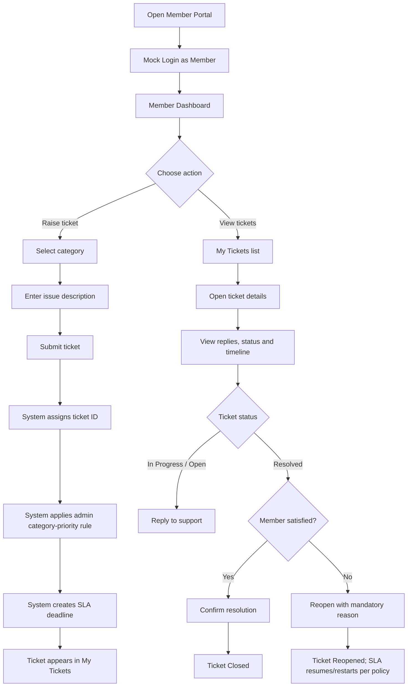
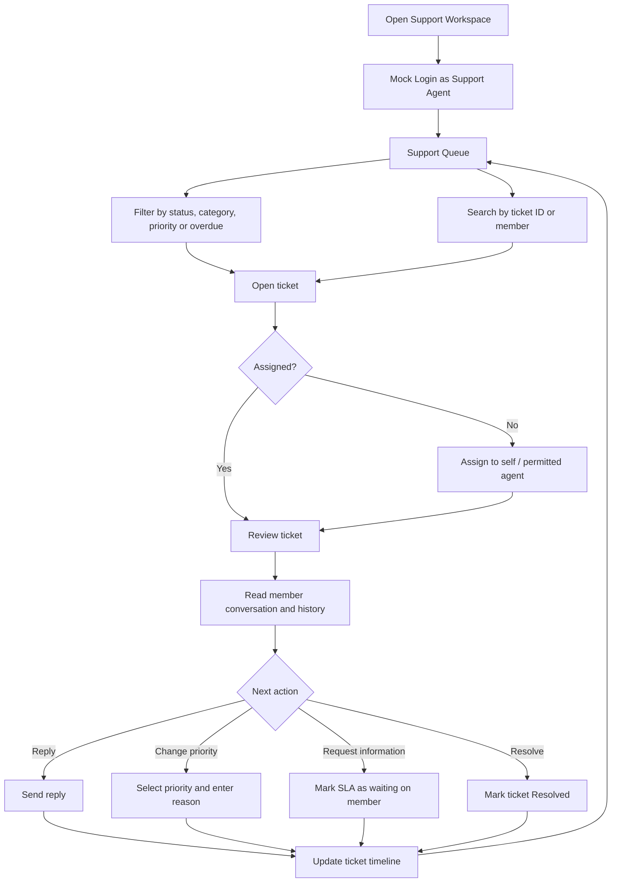
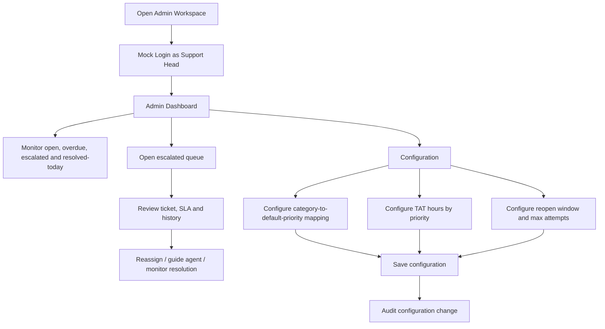
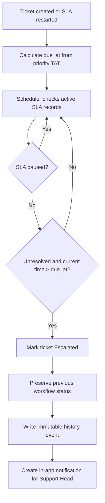

# User Flows

## 1. Member flow

### Member screens
1. Login / demo role selection
2. Member dashboard with ticket counts and recent tickets
3. Raise ticket form
4. My Tickets list with status, category, priority and created date
5. Ticket detail with threaded replies and action controls
6. Resolution confirmation and reopen-reason dialog

## 2. Support Agent flow

### Support Agent screens
1. Queue overview with KPI cards
2. Filterable/searchable ticket table
3. Ticket detail and conversation thread
4. Assignment control
5. Reply composer
6. Priority-change dialog with mandatory reason
7. Resolve action

## 3. Support Head / Admin flow

### Support Head screens
1. Admin dashboard and analytics
2. Escalated ticket queue
3. Ticket detail with full audit history
4. Category priority configuration
5. Priority-based TAT configuration
6. Reopen policy configuration

## 4. Escalation and SLA flow

## 5. Key navigation map

- Member: Dashboard → Raise Ticket / My Tickets → Ticket Detail
- Agent: Queue → Ticket Detail → Reply / Assign / Resolve
- Support Head: Dashboard → Escalated Queue / Configuration → Ticket Detail
