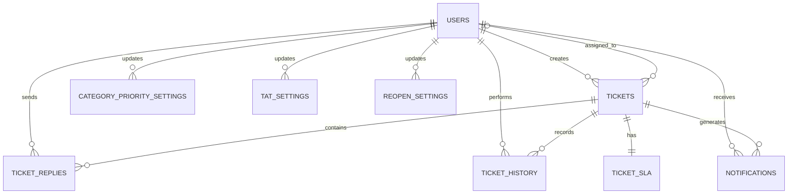

# Database Design

## Design principles
- Use PostgreSQL with SQLAlchemy and Alembic migrations.
- Use foreign keys for relational integrity.
- Store timestamps as timezone-aware UTC values.
- Keep current ticket state on `tickets`; preserve every important transition in `ticket_history`.
- Keep the actual ticket priority separate from the admin's default category-priority rule.
- Keep SLA timing data separate from ticket workflow status.

## Tables

### 1. `users`
| Column | Type | Notes |
|---|---|---|
| id | UUID / integer PK | Primary key |
| name | VARCHAR(120) | Required |
| email | VARCHAR(255) | Unique; demo login identifier |
| phone | VARCHAR(20) | Optional |
| role | ENUM | MEMBER, SUPPORT_AGENT, SUPPORT_HEAD |
| is_active | BOOLEAN | Default true |
| created_at | TIMESTAMPTZ | UTC |

### 2. `tickets`
| Column | Type | Notes |
|---|---|---|
| id | BIGINT PK | Internal key |
| ticket_number | VARCHAR(20) | Unique, e.g. TKT-0042 |
| member_id | FK users.id | Ticket owner |
| assigned_to | FK users.id | Nullable support agent |
| category | ENUM | PAYMENT, PROFILE_CHANGE, SURVEY_ISSUE, ELIGIBILITY, OTHER |
| priority | ENUM | LOW, MEDIUM, HIGH |
| status | ENUM | OPEN, IN_PROGRESS, RESOLVED, CLOSED, REOPENED, ESCALATED |
| description | TEXT | Initial issue |
| previous_status | ENUM | Nullable; used to preserve state on escalation |
| created_at | TIMESTAMPTZ | UTC |
| updated_at | TIMESTAMPTZ | UTC |
| resolved_at | TIMESTAMPTZ | Nullable |
| closed_at | TIMESTAMPTZ | Nullable |
| reopen_count | INTEGER | Default 0 |

### 3. `ticket_replies`
| Column | Type | Notes |
|---|---|---|
| id | BIGINT PK | Primary key |
| ticket_id | FK tickets.id | Parent ticket |
| sender_id | FK users.id | Author |
| message | TEXT | Required |
| is_internal | BOOLEAN | Default false; internal notes not visible to members |
| created_at | TIMESTAMPTZ | UTC |

### 4. `ticket_history`
| Column | Type | Notes |
|---|---|---|
| id | BIGINT PK | Primary key |
| ticket_id | FK tickets.id | Parent ticket |
| actor_id | FK users.id | User or system actor |
| action | VARCHAR(60) | e.g. STATUS_CHANGED, PRIORITY_CHANGED, ESCALATED |
| old_value | JSONB | Nullable |
| new_value | JSONB | Nullable |
| reason | TEXT | Required for priority change, reopen and escalation |
| created_at | TIMESTAMPTZ | UTC |

### 5. `category_priority_settings`
| Column | Type | Notes |
|---|---|---|
| id | BIGINT PK | Primary key |
| category | ENUM | Unique category |
| default_priority | ENUM | LOW, MEDIUM, HIGH |
| updated_by | FK users.id | Support Head |
| updated_at | TIMESTAMPTZ | UTC |

### 6. `tat_settings`
| Column | Type | Notes |
|---|---|---|
| id | BIGINT PK | Primary key |
| priority | ENUM | Unique priority |
| resolution_hours | INTEGER | Positive number |
| updated_by | FK users.id | Support Head |
| updated_at | TIMESTAMPTZ | UTC |

### 7. `ticket_sla`
| Column | Type | Notes |
|---|---|---|
| id | BIGINT PK | Primary key |
| ticket_id | FK tickets.id | Unique; one current SLA record per ticket |
| started_at | TIMESTAMPTZ | Current SLA cycle start |
| due_at | TIMESTAMPTZ | Current deadline |
| is_paused | BOOLEAN | Default false |
| paused_at | TIMESTAMPTZ | Nullable |
| total_paused_seconds | BIGINT | Default 0 |
| escalated_at | TIMESTAMPTZ | Nullable |
| last_calculated_at | TIMESTAMPTZ | Useful for diagnostics |

### 8. `reopen_settings`
| Column | Type | Notes |
|---|---|---|
| id | BIGINT PK | Single active configuration row |
| reopen_window_days | INTEGER | Number of days after resolution |
| max_reopens | INTEGER | Maximum reopen count |
| updated_by | FK users.id | Support Head |
| updated_at | TIMESTAMPTZ | UTC |

### 9. `notifications`
| Column | Type | Notes |
|---|---|---|
| id | BIGINT PK | Primary key |
| recipient_id | FK users.id | Usually Support Head for escalations |
| ticket_id | FK tickets.id | Related ticket |
| type | VARCHAR(50) | e.g. TICKET_ESCALATED |
| message | TEXT | Display text |
| is_read | BOOLEAN | Default false |
| created_at | TIMESTAMPTZ | UTC |

## Entity relationship diagram

## Important constraints and indexes
- Unique index on `tickets.ticket_number`.
- Index `tickets.status`, `tickets.category`, `tickets.priority`, `tickets.created_at`, `tickets.assigned_to`.
- Composite indexes for common queue filters, such as `(status, priority)` and `(category, status)`.
- Index `ticket_sla.due_at` for scheduler scans.
- Unique constraint on `category_priority_settings.category`.
- Unique constraint on `tat_settings.priority`.
- Check constraints: positive TAT hours, non-negative reopen count and paused seconds.
- Validate role permissions in the service/API layer; do not rely on frontend hiding controls.

## Ticket number generation
Generate ticket numbers using a database-backed sequence or a dedicated counter, not `COUNT(*) + 1`, to avoid duplicate IDs during concurrent submissions. Format the allocated integer as `TKT-{number:04d}`.

## Design note
`ticket_sla` stores the active SLA cycle. `ticket_history` stores the audit trail. If the product later needs a full SLA-cycle history for every reopen or priority change, introduce a separate `ticket_sla_events` or `ticket_sla_cycles` table.
