# System Architecture — Mermaid Source

```mermaid
flowchart LR
    subgraph USERS["User roles"]
        M[Member]
        A[Support Agent]
        H[Support Head / Admin]
    end

    subgraph FE["Frontend — React + Vite"]
        UI[Role-aware application]
        MP[Member portal<br/>Mobile-first]
        AQ[Agent queue and ticket workspace]
        AD[Admin dashboard and configuration]
        API_CLIENT[API client and form validation]
        UI --> MP
        UI --> AQ
        UI --> AD
        MP --> API_CLIENT
        AQ --> API_CLIENT
        AD --> API_CLIENT
    end

    subgraph BE["Backend — FastAPI"]
        ROUTES[API routes]
        SCHEMAS[Pydantic schemas]
        AUTH[Authentication and role permissions]
        SERVICES[Application services]
        TICKET_SVC[Ticket and reply service]
        PRIORITY_SVC[Priority and configuration service]
        SLA_SVC[SLA and escalation service]
        ANALYTICS[Dashboard analytics]
        ROUTES --> SCHEMAS --> AUTH --> SERVICES
        SERVICES --> TICKET_SVC
        SERVICES --> PRIORITY_SVC
        SERVICES --> SLA_SVC
        SERVICES --> ANALYTICS
    end

    subgraph DB["PostgreSQL"]
        USERS[(Users)]
        TICKETS[(Tickets)]
        REPLIES[(Ticket replies)]
        HISTORY[(Ticket history)]
        SETTINGS[(Priority and TAT settings)]
        SLA[(Ticket SLA state)]
        NOTIFS[(Notifications)]
    end

    subgraph JOB["Background scheduler"]
        CRON[Periodic SLA check<br/>e.g. every 60 seconds]
        DUE{Active, unpaused<br/>and overdue?}
        ESC[Escalate idempotently]
        EVENT[Write audit event]
        ALERT[Notify Support Head]
        CRON --> DUE
        DUE -- Yes --> ESC
        ESC --> EVENT
        ESC --> ALERT
    end

    M --> UI
    A --> UI
    H --> UI
    API_CLIENT -- HTTPS / REST JSON --> ROUTES
    TICKET_SVC --> TICKETS
    TICKET_SVC --> REPLIES
    TICKET_SVC --> HISTORY
    PRIORITY_SVC --> SETTINGS
    SLA_SVC --> SLA
    SLA_SVC --> HISTORY
    ANALYTICS --> TICKETS
    ROUTES --> USERS
    CRON --> SLA
    DUE -- No --> CRON
    ESC --> TICKETS
    EVENT --> HISTORY
    ALERT --> NOTIFS
    NOTIFS -. In-app alert .-> H

    classDef frontend fill:#EAF1FF,stroke:#2563EB,color:#172B4D
    classDef backend fill:#E5F6F3,stroke:#0F766E,color:#172B4D
    classDef database fill:#F1EAFE,stroke:#6D28D9,color:#172B4D
    classDef scheduler fill:#FFF3E0,stroke:#B45309,color:#172B4D

    class UI,MP,AQ,AD,API_CLIENT frontend
    class ROUTES,SCHEMAS,AUTH,SERVICES,TICKET_SVC,PRIORITY_SVC,SLA_SVC,ANALYTICS backend
    class USERS,TICKETS,REPLIES,HISTORY,SETTINGS,SLA,NOTIFS database
    class CRON,DUE,ESC,EVENT,ALERT scheduler
```

## Notes
- The application is a modular monolith: one React frontend, one FastAPI backend and one PostgreSQL database.
- The scheduler checks SLA deadlines periodically and creates escalation history and notifications.
- Backend authorization is authoritative; frontend role-based routing is for navigation and user experience.
- Timestamps are stored in UTC and displayed in Asia/Kolkata.
- For a production deployment with multiple backend instances, run the scheduler as a dedicated worker or use distributed locking.
